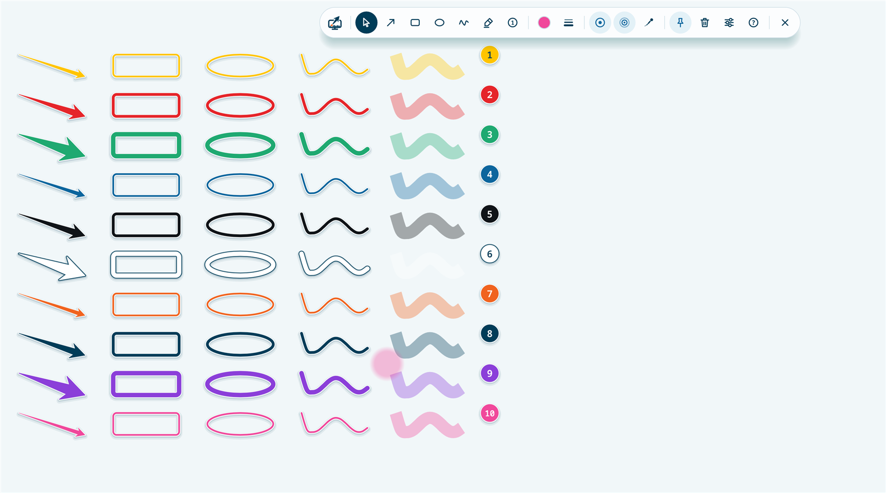
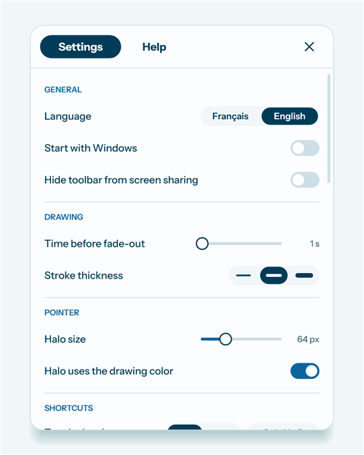
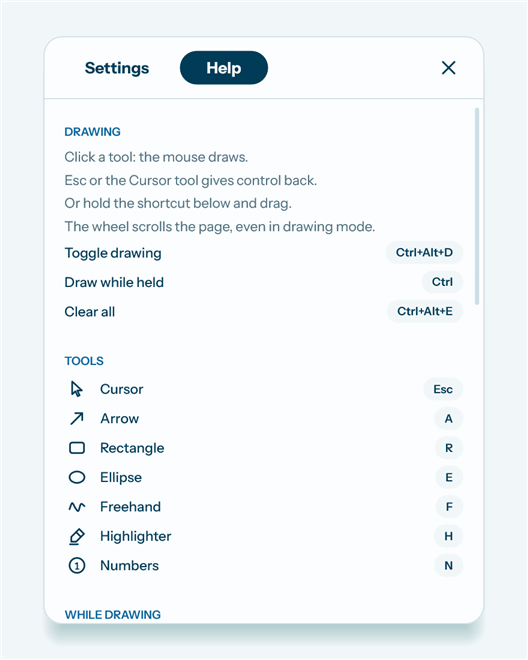

# Ekspointer


Ekspointer highlights your mouse pointer and lets you draw arrows, boxes and other shapes on top of any Windows application. The shapes fade away on their own after a moment. It is made for teaching and presenting, on a video call or in a room.

<br clear="left">

**[Download the latest version](https://github.com/lwiart/Ekspointer/releases/latest)** (installer or portable executable, Windows 10 and 11)



## How it works

Ekspointer shows a small floating toolbar. Everything you draw appears above your other windows and disappears after one second (you can set this from 1 to 15 seconds).


There are two ways to draw.

- **Hold a key.** Hold the left `Ctrl` key and drag the mouse: it draws with the current tool. Release the key and the mouse works normally again. This is the quickest way to point at something while you keep working.
- **Switch to drawing mode.** Click a tool in the toolbar, or press `Ctrl+Alt+D`. The mouse now draws until you press `Esc` or click the Cursor tool. The mouse wheel still scrolls the page underneath.

While you draw, hold `Shift` to snap an arrow to 15° steps, or to get a square, a circle or a straight highlighter line.

### Tools

| Tool | Shortcut in drawing mode |
|---|---|
| Arrow | `A` |
| Rectangle | `R` |
| Ellipse | `E` |
| Freehand | `F` |
| Highlighter | `H` |
| Numbers (numbered steps, one per click) | `N` |
| Colors 1 to 10 | `1` to `9`, then `0` |
| Undo last shape | `Ctrl+Z` |

These are the English shortcuts. With the interface in French, tools use the first letter of their French name (`F`, `R`, `C`, `D`, `S`, `N`).


### Pointer effects

Three effects make the pointer easier to follow. Each one has a button in the toolbar and a shortcut.

| Effect | What it does | Shortcut |
|---|---|---|
| Halo | A soft colored disc follows the pointer | `Ctrl+Alt+H` |
| Click ripple | A ring expands at every click | `Ctrl+Alt+R` |
| Laser trail | The pointer leaves a short glowing trail | `Ctrl+Alt+T` |

### Other toolbar buttons

| Button | What it does | Shortcut |
|---|---|---|
| Keep drawings on screen | Shapes stay until you clear them | `Ctrl+Alt+K` |
| Clear all | Removes every shape | `Ctrl+Alt+E` |
| Settings | Opens the settings panel | `Ctrl+Alt+S` |
| Help | Opens the built-in help page | `Ctrl+Alt+F1` |
| Cross | Quits Ekspointer | |

Drag the toolbar by its logo or by any gap between buttons. Double-click the logo to collapse it.

## Settings and help

The settings panel starts with the language (French or English), starting with Windows, and hiding the toolbar from screen sharing. Then come drawing, pointer and shortcut settings. The Help tab lists every button with its icon and current shortcut.

 

Every shortcut can be changed. A global shortcut can be a key combination or a quick **double tap** on one key, such as `2×Ctrl` or `2×Tab`. The key you hold to draw can be one or more of Ctrl, Alt, Shift and Win, or a single function key (F1 to F12).

Things to know about shortcuts:

- While you hold `Ctrl` to draw, `Ctrl+click` draws instead of reaching the application. `Ctrl+C`, `Ctrl+wheel` and other shortcuts are not affected. Choose a function key if this gets in your way.
- Global shortcuts work in every application. If one clashes with an application you use, change it in the settings.
- Only the left Ctrl and Alt keys count, so AltGr never triggers a shortcut.
- With a regular key such as Tab, the first tap of a double tap still reaches the current application.

## Screen sharing

Your audience sees the shapes and pointer effects when you share your **entire screen**. If you share a single window or browser tab, the video call tool does not transmit them.

You can hide the toolbar from screen sharing in the settings, so that only the drawings are shown. This needs Windows 10 version 2004 or later.

## Installation

Download the files from the [latest release](https://github.com/lwiart/Ekspointer/releases/latest), under "Assets". Older versions are on the [Releases page](https://github.com/lwiart/Ekspointer/releases).

- `Ekspointer-Setup-x.y.z.exe` installs Ekspointer for your user account, without administrator rights, in `%LOCALAPPDATA%\Programs\Ekspointer`. Settings are saved in the same folder (`config.json`). Running a newer installer updates the application and keeps your settings.
- `Ekspointer-x.y.z-portable.exe` runs without installation and saves its settings next to itself.

The files are not signed, so Windows SmartScreen shows a warning the first time. Click "More info", then "Run anyway".

Ekspointer runs on Windows 10 and Windows 11, 64-bit. It is a single executable of less than 1 MB, written in Rust, with nothing else to install.

To quit, click the cross at the end of the toolbar, or right-click the Ekspointer icon in the notification area and choose Quit.

## Building from source

You need [Rust](https://rustup.rs/), the Visual Studio Build Tools with the C++ tools, and [Inno Setup 6](https://jrsoftware.org/isinfo.php) for the installer.

Run the commands from the project folder.

In PowerShell or the Windows command prompt:

```powershell
scripts\cargo.cmd build --release                                     # the executable only, in target\release\
scripts\cargo.cmd test                                                # unit and integration tests
scripts\cargo.cmd test --test process -- --ignored --test-threads=1   # tests that run the real executable
powershell -ExecutionPolicy Bypass -File scripts\build-release.ps1    # everything, output in dist\
```

In Git Bash:

```bash
cmd //c "scripts\\cargo.cmd build --release"                                     # the executable only, in target/release/
cmd //c "scripts\\cargo.cmd test"                                                # unit and integration tests
cmd //c "scripts\\cargo.cmd test --test process -- --ignored --test-threads=1"   # tests that run the real executable
powershell -ExecutionPolicy Bypass -File scripts/build-release.ps1               # everything, output in dist/
```

`scripts\cargo.cmd` runs `cargo` inside the Visual Studio build environment. In Git Bash, write `cmd //c` with two slashes (a single `/c` is turned into a path), and do not call `cargo` directly: Git Bash has its own `link` command, which hides the Visual Studio linker.

The last command runs the tests, builds the executable, then creates the installer and the portable executable. The tests that run the real executable open windows briefly, move the pointer for a second and send a few keystrokes.

The icon and the installer images are generated from `assets/logo.svg` with `scripts\cargo.cmd run -p icon-gen`.

## Code layout

- `src/` (library): the logic, with no dependency on Windows, covered by unit tests. Shapes and their life cycle (`shapes`), pointer effects (`pointer`), shortcuts (`shortcuts`), settings (`config`), input filtering (`input_filter`), application state (`app`), translations (`i18n`), interface layouts (`ui`).
- `src/win/` (executable): the Windows layer. One transparent window per screen (`overlay`), Direct2D rendering (`gfx`, `render`), keyboard and mouse hooks (`input`), toolbar and settings (`panel`, `ui`, `settings_view`, `icons`), notification area (`tray`).
- `tests/`: integration tests.
- `docs/superpowers/`: design spec and implementation plan (in French).

The Instrument Sans and Noto Sans Mono fonts are embedded under the OFL license (`assets/fonts/`).

## Credits

Ekspointer is created by Laurent Wiart, [Eksplodo](https://eksplodo.fr/): training and consulting in automation and AI.
